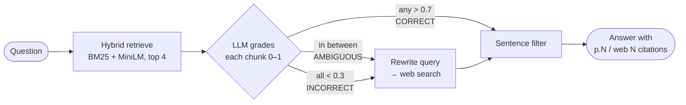

# CRAG — Corrective RAG: Ask Any PDF

**Live demo:** [crag-app-tawny.vercel.app](https://crag-app-tawny.vercel.app)

Upload a PDF and ask it questions. Unlike a basic RAG chatbot, CRAG **checks its own sources** before it answers. It grades every retrieved passage for relevance, and when your document doesn't cover the question it falls back to web search. Answers cite their sources, either pages in your PDF (`[p.12]`) or web results (`[web 1]`), so every claim can be traced.

Based on the *Corrective Retrieval-Augmented Generation* idea (Yan et al., 2024), built as a LangGraph state machine with a FastAPI backend.

---

## Features

- **Ask any PDF.** Upload a document and it's split into page-tagged chunks and indexed in seconds, with a progress bar.
- **Hybrid retrieval.** BM25 handles exact keywords and MiniLM embeddings handle meaning. The two rankings are fused with reciprocal rank fusion.
- **Self-grading.** An LLM scores each retrieved chunk from 0 to 1 and decides whether the PDF is enough, partly enough, or not relevant.
- **Web fallback.** Questions the PDF can't answer are rewritten into a search query and answered from Tavily web results.
- **Sentence-level filtering.** Only sentences that actually help answer the question reach the final prompt.
- **Cited answers.** Every sentence cites `[p.N]` or `[web N]`.
- **Transparent pipeline trace.** For each answer you see the verdict, each chunk's score, how much of the evidence came from the PDF versus the web, the pages and URLs used, the number of LLM calls, and the latency.
- **Per-PDF stats.** Shows what share of questions each document could answer by itself.
- **Works out of the box.** A demo book (Bishop, *Pattern Recognition and Machine Learning*, 758 pages) is pre-indexed into the image.

## How it works



| Verdict | When | Evidence used |
|---|---|---|
| **CORRECT** | At least one chunk scores above 0.7 | PDF only |
| **AMBIGUOUS** | No chunk above 0.7, but not all below 0.3 | PDF + web |
| **INCORRECT** | Every chunk scores below 0.3 | Web only |

**Indexing.** The PDF is read page by page and split into 900-character chunks with a 150-character overlap. Each chunk keeps its page number. The chunks are embedded with `all-MiniLM-L6-v2` (384 dimensions, run through ONNX) and stored in a per-document FAISS index alongside a BM25 index.

**Answering.** The 20 best candidates from each retriever are fused, and the top 4 are graded. Depending on the verdict, the app keeps the relevant PDF chunks, web results, or both. It splits them into sentences, filters them in batches of 25, and generates an answer that is allowed to use only the filtered context.

## Tech stack

| Layer | Tools |
|---|---|
| Orchestration | LangGraph |
| LLM | `meta-llama/llama-3.3-70b-instruct` via OpenRouter (any OpenAI-compatible API works) |
| Embeddings | `all-MiniLM-L6-v2` via fastembed (ONNX, no PyTorch) |
| Retrieval | FAISS `IndexFlatIP` (cosine) + BM25 (`rank-bm25`), reciprocal rank fusion |
| Web search | Tavily |
| Backend | FastAPI, Uvicorn |
| Frontend | Vanilla HTML / CSS / JavaScript |
| Storage | Local disk, plus Vercel Blob for uploads on serverless hosts |
| Deployment | Docker, Vercel (container functions), Render |

## Getting started

**Prerequisites:** Python 3.11, an [OpenRouter](https://openrouter.ai) API key, and optionally a [Tavily](https://tavily.com) API key to turn on web search.

```bash
git clone https://github.com/Aditya365x/CRAG.git
cd CRAG

python -m venv .venv
.venv\Scripts\activate            # macOS / Linux: source .venv/bin/activate
pip install -r requirements.txt

cp .env.example .env              # Windows: copy .env.example .env, then add your keys

python -m app.seed_demo           # optional: pre-index the demo book (~2 min)
uvicorn app.api:app --port 8000
```

Open http://localhost:8000 for the app, or http://localhost:8000/docs for the interactive API docs.

### Run with Docker

```bash
docker build -t crag-app .
docker run -p 7860:7860 -e LLM_API_KEY=... -e TAVILY_API_KEY=... crag-app
```

The image includes the embedding model and the pre-built demo index, so the container starts in seconds.

## Configuration

All settings are environment variables (see [`.env.example`](.env.example)):

| Variable | Default | Purpose |
|---|---|---|
| `LLM_API_KEY` | — | API key for the LLM provider (`OPENROUTER_API_KEY` also works) |
| `LLM_BASE_URL` | `https://openrouter.ai/api/v1` | Any OpenAI-compatible endpoint, e.g. Groq |
| `LLM_MODEL` | `meta-llama/llama-3.3-70b-instruct` | Must support tool calling |
| `TAVILY_API_KEY` | — | Turns on the web-search fallback |
| `MAX_PAGES` | `400` | Pages indexed per uploaded PDF |
| `MAX_UPLOAD_MB` | `40` | Upload size limit |
| `EMBED_BATCH` | `8` | Embedding batch size; keeps peak memory under 512 MB |
| `DATA_DIR` | `./data` | Where document indexes are stored |
| `BLOB_READ_WRITE_TOKEN` | — | When set, uploads are mirrored to Vercel Blob |

## API

| Method | Endpoint | Description |
|---|---|---|
| `POST` | `/api/upload` | Upload a PDF (multipart field `file`) and index it |
| `GET` | `/api/status/{doc_id}` | Indexing status and progress |
| `GET` | `/api/docs` | All documents with metadata and per-PDF stats |
| `POST` | `/api/query` | Ask a question: `{"doc_id": "...", "question": "..."}` |
| `GET` | `/api/report/{doc_id}` | Share of answers from the PDF, PDF + web, and web only |
| `GET` | `/api/config` | Embedding and retrieval settings |
| `GET` | `/api/health` | Health check |

<details>
<summary>Example <code>/api/query</code> response (abridged, illustrative values)</summary>

```json
{
  "question": "What is the bias-variance trade-off?",
  "answer": "The bias-variance trade-off refers to the balance between bias and variance ... [p.169]",
  "verdict": "CORRECT",
  "reason": "At least one chunk scored > 0.7.",
  "best_book_score": 1.0,
  "chunk_scores": [{ "rank": 1, "page": 169, "score": 1.0, "used": true, "preview": "..." }],
  "evidence_from_book_pct": 100,
  "evidence_from_web_pct": 0,
  "book_pages_used": [169],
  "web_query": "",
  "web_sources": [],
  "sentences_in": 31,
  "sentences_kept": 4,
  "llm_calls": 6,
  "latency_s": 9.2,
  "cached": false,
  "book_report": { "questions": 1, "correct_pct": 100, "ambiguous_pct": 0, "incorrect_pct": 0 }
}
```
</details>

## Deployment

Each host runs the same Docker image. Set `LLM_API_KEY` (or `OPENROUTER_API_KEY`) and `TAVILY_API_KEY` as secrets.

- **Vercel:** [`Dockerfile.vercel`](Dockerfile.vercel) runs the app as a container function. Vercel uses many short-lived instances, so connect a private Blob store (`vercel blob create-store <name> --access private`). Uploaded documents are then shared by every instance. Run `vercel deploy --prod` to deploy.
- **Render:** *New → Blueprint* and pick this repo. [`render.yaml`](render.yaml) defines the service, and it runs on the free plan.

## Performance

Measured on the demo book:

| | Result |
|---|---|
| Question covered by the PDF | CORRECT, ~9 s, 6 LLM calls |
| Question outside the PDF (web fallback) | INCORRECT → web, ~38 s, 8 LLM calls |
| Indexing a 20-page PDF | ~2–4 s |
| Indexing the 758-page demo book | ~2 min (done at image build time) |
| Peak memory (queries + an upload) | ~390 MB, under a 512 MB cap |
| Repeated question | Served from cache, instant |

## Limitations

- Scanned PDFs need OCR first; the app only reads PDFs that contain a text layer.
- Uploads over 4.5 MB fail on Vercel, the platform's request size limit.
- Without a Blob store (local or Render), uploads are kept on the container's disk and are lost when it restarts. The demo book is always available.
- Each question makes 6–9 LLM calls, so answers take seconds, not milliseconds.

## Project structure

```
├── app/
│   ├── config.py       # settings, all overridable with environment variables
│   ├── ingest.py       # PDF → page-aware chunks → MiniLM embeddings → FAISS
│   ├── retrieval.py    # hybrid BM25 + vector search with reciprocal rank fusion
│   ├── graph.py        # the CRAG LangGraph state machine
│   ├── service.py      # runs a question, builds the report and per-PDF stats
│   ├── storage.py      # optional Vercel Blob mirror for uploaded documents
│   ├── api.py          # FastAPI app: REST API + web UI
│   ├── seed_demo.py    # pre-indexes the demo book at build time
│   ├── static/         # style.css, script.js
│   └── templates/      # index.html
├── documents/          # demo PDF
├── Dockerfile          # Render / generic Docker
├── Dockerfile.vercel   # Vercel container
├── render.yaml         # Render blueprint
├── requirements.txt
└── .env.example
```

## References

- Yan, S. et al. (2024). *Corrective Retrieval Augmented Generation.* [arXiv:2401.15884](https://arxiv.org/abs/2401.15884)
- [LangGraph](https://langchain-ai.github.io/langgraph/) · [FastEmbed](https://github.com/qdrant/fastembed) · [FAISS](https://github.com/facebookresearch/faiss) · [Tavily](https://tavily.com)
